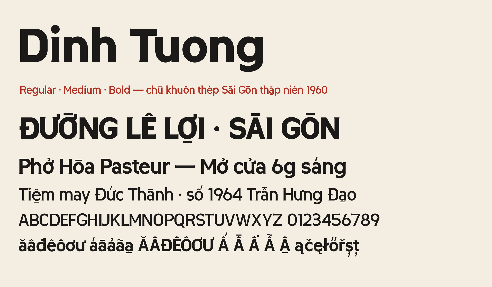

# Dinh Tuong



Dinh Tuong is a display typeface drawn from the cast-steel stencil lettering of the shop signs and gate signs of 1960s Saigon. Every glyph is built from rules, with ruler and compass only. The Vietnamese marks are cut from the same strip as the letters rather than added on top.

- 3 weights: Regular, Medium, Bold
- Character set: GF Latin Core + GF Latin Vietnamese (Vietnamese, English, French, Spanish, Polish, Czech, Slovak, Hungarian, Romanian, Turkish, Latvian, Lithuanian, Maltese, German and more)
- Tabular figures (`tnum`)

Tiếng Việt: Dinh Tuong là kiểu chữ trưng bày dựng theo chữ khuôn thép đúc trên biển hiệu, biển cổng Sài Gòn thập niên 1960. Mỗi glyph dựng theo luật, chỉ bằng thước và compa. Dấu tiếng Việt cắt từ cùng một tấm thép với chữ, không gắn thêm.

## Building

The sources are the rule-based Python generators in `sources/`. They draw every glyph from its construction rules and write the font binaries.

```sh
make build        # = sh sources/build.sh  ->  fonts/otf, fonts/ttf (and sources/ufo for inspection)
make test         # fontspector, Google Fonts profile (needs fontspector)
make proof        # HTML proofs (needs diffenator3)
```

Requirements are pinned in `requirements.txt` (Python 3.11 or later).

## Changelog

See `documentation/CHANGELOG.md`.

## License

This Font Software is licensed under the SIL Open Font License, Version 1.1. This license is available with a FAQ at https://openfontlicense.org

## Repository layout

This font repository follows the [Google Fonts project template](https://github.com/googlefonts/googlefonts-project-template):

- `sources/`: the generators and the build script
- `fonts/`: the font binaries, one folder per format
- `documentation/`: specimen, article and changelog
